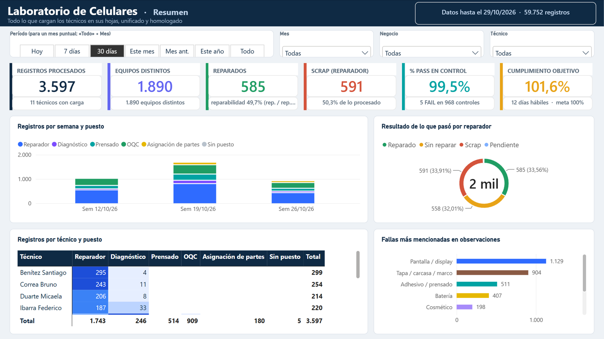
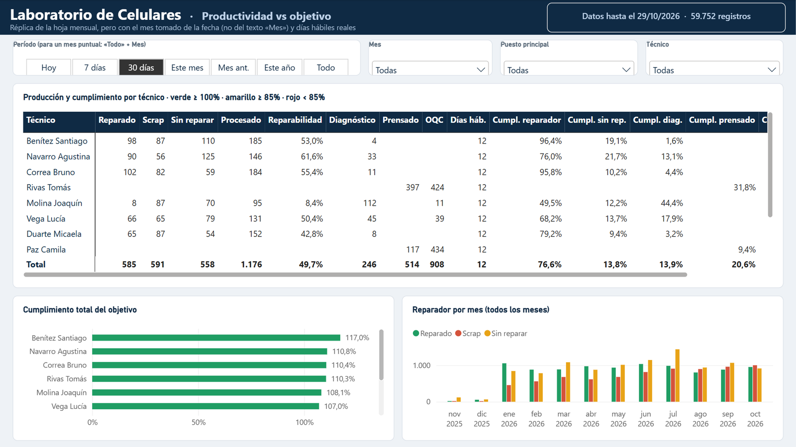
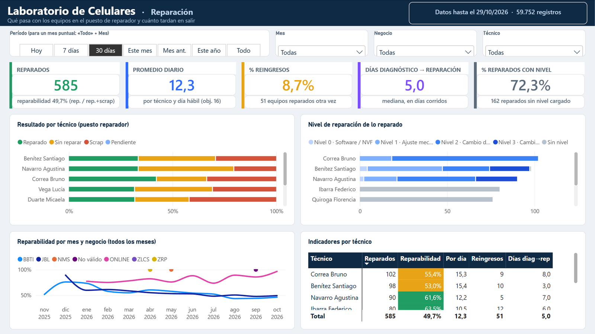
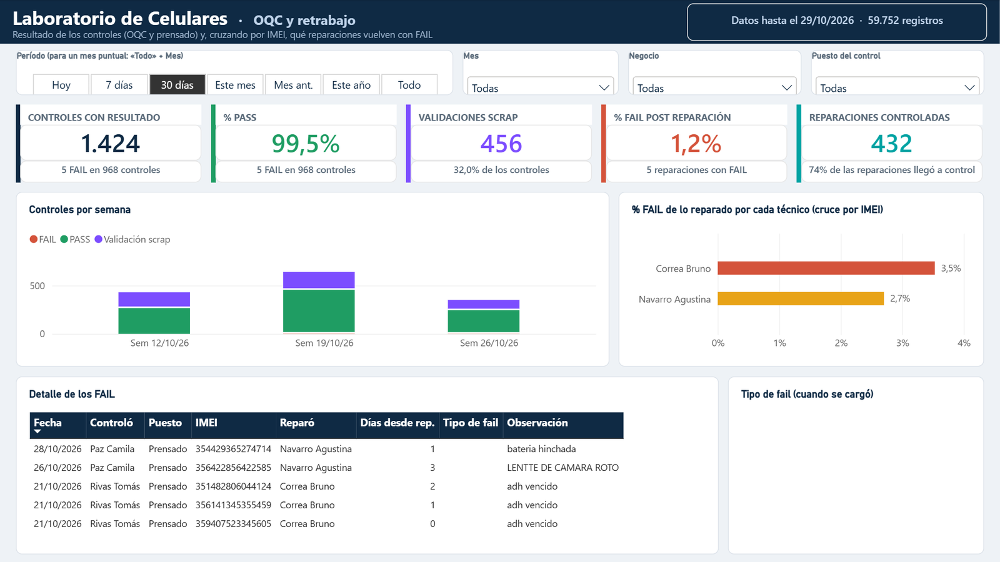
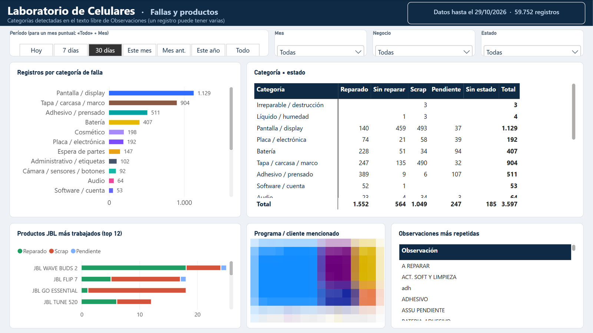
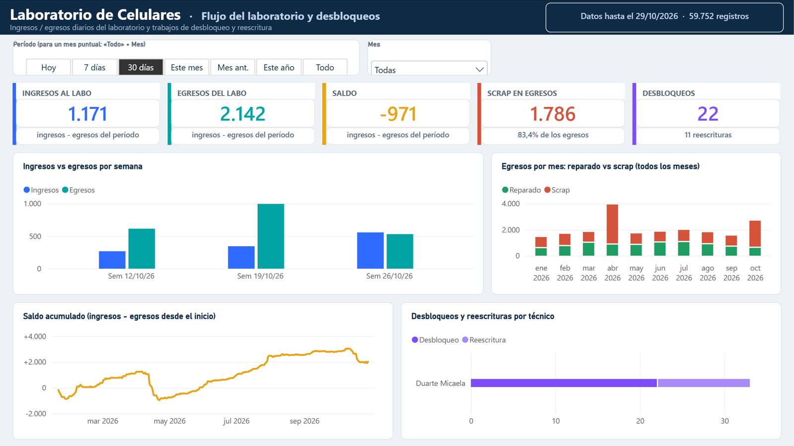
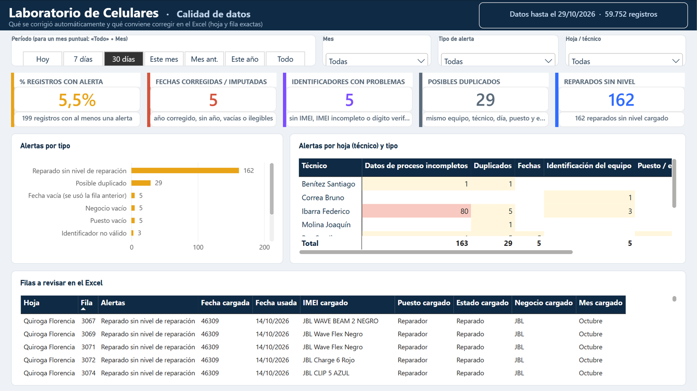
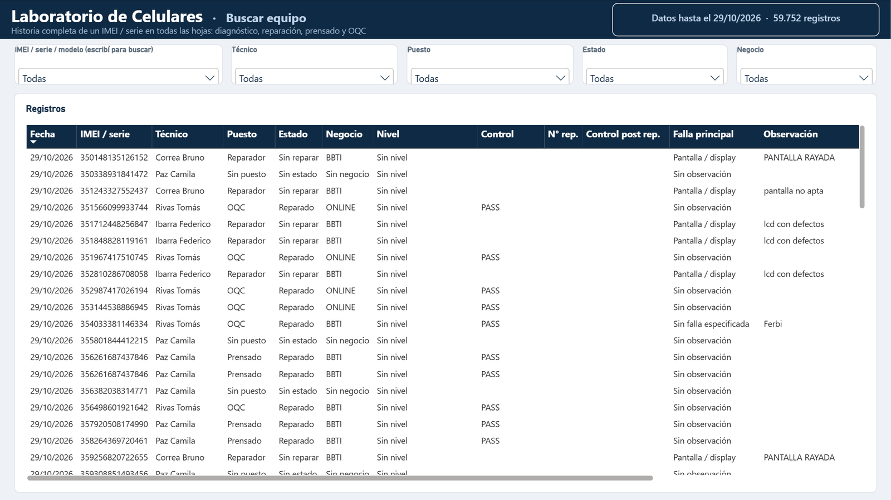

# 🔧 Phone Repair Lab

> Operational dashboard for a **mobile phone repair lab**: how many devices each technician repairs, diagnoses or presses, how that compares with the daily target, how many come back after quality control (OQC) and which failures show up most.

*The report itself (page names, measures, labels) is in Spanish.*

> 📸 The data is **anonymized**: technician names, employee IDs and device identifiers (IMEI / serial numbers) were replaced with fake ones. Volumes and dates keep the shape of the real operation.

## 📌 Questions it answers

- How many devices did each technician repair, scrap or leave unrepaired, and what is the **repairability** rate?
- Is each technician hitting the **daily target** for repair, diagnosis, pressing and OQC (business days and holidays included)?
- What share of repaired devices **fails OQC**, and how many come back as **rework**?
- Which **failure categories** and products are most frequent?
- How many devices enter and leave the lab, and how big is the backlog?
- How clean is the source data, and which rows need fixing?

## 🧹 The hard part: cleaning a hand-filled Excel

The source is a workbook with **one sheet per technician**, filled by hand. Power Query does most of the work, and every rule runs again on each refresh:

- **Sheet discovery:** every sheet with the expected headers is read, so a new technician's sheet is picked up automatically. Columns are found by name with synonyms, not by position.
- **Dates:** text dates (`28/05/2026`, `21/1`, `22-1`) are parsed, impossible years and swapped day/month are fixed, and missing dates are imputed from the previous row and flagged.
- **Identifiers:** IMEIs are extracted from messy text and checked with the Luhn check digit; serial numbers, order numbers and part codes are told apart by pattern.
- **Device history:** matching by IMEI rebuilds each device's story: repair number (rework), later quality check and who repaired it.
- **Normalization:** workstation, status and business unit are matched regardless of case, accents or spaces; values in the wrong column become "No válido" and raise an alert.
- **Failure categories:** free-text notes are classified by keywords (screen, cover, battery, board…), tolerant to typos.

A dedicated report page explains these rules, and a **data quality** page lists every alert so the team can fix the source.

## 🧱 Data model

| Table | Content |
|---|---|
| `Registros` | One row per lab record (fact table, 40+ columns after cleaning) |
| `Fallas` / `Categorías falla` | Failures detected per record and their categories |
| `Alertas` | Data quality issues per record |
| `Desbloqueos` | Unlock and firmware rewrite jobs |
| `Flujo laboratorio` | Devices in and out of the lab per day |
| `Técnicos` / `Legajos` | Technicians and their sheets |
| `Objetivos` | Daily targets per activity |
| `Calendario` / `Feriados` / `Periodos` | Date dimension, holidays and period selector |
| `Medidas` | 100+ DAX measures |

## 📐 Main measures

| Group | Measures |
|---|---|
| Repair | Repaired, scrap, unrepaired, pending, repairability, % scrap |
| Targets | Business days per technician, target and attainment per activity, total attainment |
| Quality (OQC) | Inspections, PASS / FAIL, % FAIL after repair, rework rate, days from diagnosis to repair |
| Failures | Failure mentions, % of records with each failure |
| Lab flow | Inflow, outflow, balance, cumulative backlog |
| Data quality | Records with alerts, imputed dates, bad identifiers, possible duplicates |
| Formatting | `Txt …`, `Color …` and `Fondo …` measures for dynamic text and conditional formatting |

## 📄 Report pages

1. **Resumen (Summary):** main KPIs, trend and attainment per technician
2. **Productividad vs objetivo (Productivity vs. target):** attainment per activity and technician
3. **Reparación (Repair):** repaired, scrap and repairability
4. **OQC y retrabajo (OQC & rework):** quality control results and devices that came back
5. **Fallas y productos (Failures & products):** failure categories and products
6. **Flujo y desbloqueos (Lab flow & unlocks):** inflow, outflow and backlog
7. **Calidad de datos (Data quality):** alerts to fix in the source
8. **Buscar equipo (Device search):** full history of one device
9. **Cómo se limpian los datos (How the data is cleaned):** the cleaning rules

## 🖼️ More pages

| Productivity vs. target | Repair |
|---|---|
|  |  |
| **OQC & rework** | **Failures & products** |
|  |  |
| **Lab flow & unlocks** | **Data quality** |
|  |  |

Device search

## ▶️ How to open it

1. Clone the repository.
2. Open `Laboratorio de Celulares.pbip` in Power BI Desktop.
3. Under **Transform data → Parameters**, point `RutaExcel` to `demo/laboratorio_demo.xlsx` in your clone.
4. Refresh. The period slicer is relative to today, so if a page looks empty, set the period slicer to **"Todo"** (all dates).
